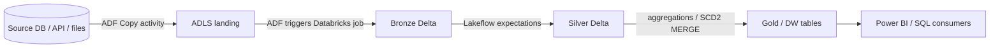

# Databricks + Spark + Lakeflow + ADF: end-to-end project walkthrough demo

A small, runnable reference project showing how a typical Azure data platform fits together, and how I mentor engineers through **understanding an existing project, daily code analysis/review, and finishing their own tasks**.

## What's inside

| Path | What it shows |
|---|---|
| `adf/pl_ingest_orders.json` | Azure Data Factory pipeline: Copy to ADLS landing zone, then trigger a Databricks job, with parameters + failure alert |
| `pipelines/lakeflow_orders.py` | Lakeflow Declarative Pipeline (formerly DLT): bronze → silver → gold with data-quality expectations |
| `pipelines/framework.py` | A tiny metadata-driven ingestion framework (config → generic Spark reader/writer), the pattern most enterprise projects use |
| `pipelines/orders_batch.py` | Plain PySpark version of the same logic (incremental MERGE into Delta) for jobs outside Lakeflow |
| `sql/sp_upsert_dim_customer.sql` | Stored-procedure-style SCD Type 2 upsert (Databricks SQL `MERGE`), plus the T-SQL equivalent for Synapse/SQL Server |
| `review/code_review_checklist.md` | The checklist I use when reviewing Spark/ADF PRs daily |
| `tests/test_framework.py` | pytest + local SparkSession tests for the framework transforms |

## Architecture



## How I'd help you (mentoring plan)

1. **Project onboarding (session 1):** we trace one table end to end, from the ADF trigger through the Databricks notebooks/Lakeflow pipeline to the final warehouse table, and draw the lineage together so the whole project "clicks".
2. **Framework deep-dive:** read your metadata/config-driven framework, find where each parameter is consumed, and how to add a new source safely.
3. **Daily code analysis & review:** you share the task or PR; we review it with the checklist in `review/`, covering correctness, incremental logic, partitioning, skew, idempotency, and cost.
4. **Guided task completion:** I pair with you while you write the code, so you finish your own tickets and learn the reasoning, not just the answer.
5. **Stored procedures & SQL:** translate legacy T-SQL procedures into Spark SQL / Delta `MERGE` and explain the differences.

## Run locally

```bash
pip install pyspark==3.5.* delta-spark==3.2.* pytest
pytest -q tests/
```

The Lakeflow file runs inside a Databricks pipeline; the framework and batch scripts run on any Spark 3.5.

---
Mentor: Mihai Chindriș, BSc Computer Science (TU Cluj), MSc Business Informatics (TU Wien), data/SAP BTP engineer. Book a session on Codementor.
